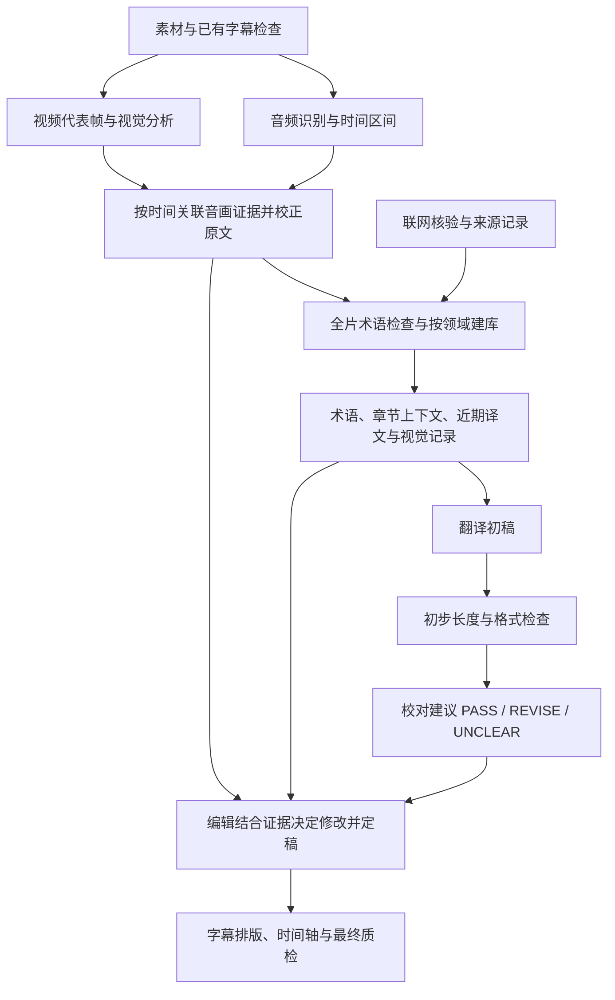

# 工作流细节

执行调度先读 [子代理岗位与交接](subagent-workflow.md)。主代理负责统筹与正式版本写入，以下各阶段由对应岗位子代理执行；输入、输出和质量门槛保持本文件及数据协议的规定。

## 上下文与文件

首次安装的下载方式选择及素材入口见 [media-intake.md](media-intake.md)。主代理保存用户偏好并冻结本任务参数；素材员在独占目录直接登记文件或下载视频链接，交回 media-manifest.json、本地媒体和摘要。主代理验收后才派转写/视觉；成功下载不能记录为完成音画分析。

工作目录按需包含 project.json、source.json、terminology/、terminology-library/、context.md、visual-memory.json、frames/、manifest.json、版本稿件、batches/、exports/。project 记录语言、地区、领域、源文件 SHA-256、实际媒体时长、工具/模型版本、视觉能力及制作阈值。manifest 分别记录 media、asr、vision、preprocess、terminology-discovery、terminology-research、terminology-bind、translate、proofread、edit、layout、qa 的状态、覆盖范围、工件摘要及下一步，不存密钥。视觉缺失要记录原因，不能默认为已执行。

术语在原文整理与记忆阶段执行全片候选发现、联网核验、领域分库及逐次消歧，具体数据协议和命令见 [terminology.md](terminology.md)。先生成 source.terms.vNN.json，再分批翻译；各批自动带入相关 term_context。context 另记章节梗概、人物指代、风格和疑点。已确认译名变更要创建新版本、重绑并重校，不能为一致性扩大已知错译。

上下文记忆区分讲者原话、实际看见的画面、解释性推断和未决候选，并保留对应源 ID 或媒体时刻。简短章节摘要也要保留这些区别；“可能在轮换护盾”不能压缩成已确认的战术过程后传给所有翻译批次。记忆用于定位上下文，不能用其流畅概括替代本句原文。后来的结果或另一时刻资源面板不回写成先前已发生的事实。

## ViDove 流程映射

参考版本：`88470bcb3d34f0f6da396ece0030b5374b6dbf47`，2026-09-06 核对源码。ViDove 主流程先做说话人分段、视觉线索、ASR、原文预处理，再翻译、后处理、校对、编辑、输出；纯 SRT 单独跳过音画阶段。源码依据及差异见 [project-sources.md](project-sources.md)。

本技能采用其阶段职责，适配 AssemblyAI 的 ASR-first 能力；不声称照搬其调度实现：

图中音频和视觉是两路输入，依赖满足且资源允许时可由转写员与视觉员并行执行。翻译、校对、编辑由不同子代理实例执行，阶段间等待上游冻结。视觉必须通过图像工具把真实帧提供给视觉员；使用 vision_workbench.py 抽帧/打包，实际看图，再由主代理验收写回证据。没有视频时明确跳过视觉；有视频且视觉不可用时记录降级。用户明确要求音画核验但无法完成时不能声称全量完成。

## 翻译、校对建议、编辑定稿

所有领域先读 [本地化与口语可读性](localization-and-naturalness.md)，建立并实际加载项目风格档案。中文自然度单独连读检查：优先明白、口语、简洁，保留必要专业性；不靠成语或修辞增加“文采”。保真审校与自然度审校均落实到保存的文本。可选 [DeepSeek 建议](deepseek-polish.md) 须先取得具体提示词批准；它只提供额外建议，正常 GPT 编辑及证据门槛继续生效。

游戏项目先读取 [游戏字幕提示词 v2](gameplay-translation-prompt-v2.md)，翻译、校对、编辑和排版均沿用同一版本。将 `meta.translation_prompt` 记录为含 `profile: gameplay-v2`、`version: 2`、提示词文件 `sha256` 的对象，在生成批次前写入；相对参考路径可记入项目记录。project_meta 随批次传递，但脚本不会自动读取提示词正文，执行代理须实际加载该参考。已建立批次后更换提示词须另存版本并重建批次、重做受影响的审校，不能沿用旧审定状态。

疑难源文维护 source_checks，详见 [review-evidence.md](review-evidence.md)。不能因为词表命中或第二个 ASR 同意就写“已听校”。校对状态、编辑状态、未决队列和报告必须一致；最终版的全片 reviewed 不允许与报告中影响译意的未决疑点并存。无法解决时交付明确标注的草稿。

翻译输入为本批 segments、只读相邻上下文、相关术语、章节概要、相关 visual_cues/audio_cues 及用户要求。视觉记录先按时间匹配，再按内容相关性挑选；不将全片所有帧塞入每个批次。输出本批 ID 的 draft JSON，保持事实、语气、笑点和俚语。原声说了什么与画面展示什么分开标注。

校对先对照原文和 draft 查遗漏/增译、数字、专名、否定、逻辑、指代及术语。只输出 proofreading_status、suggestions 和 proofreading_note：PASS 无需修改；REVISE 有明确问题和修改理由；UNCLEAR 缺少证据或怀疑源文。建议尽量指出源词、时间或 cue_id，不直接改 target。

编辑读取校对建议和可追溯证据，检查建议是否成立，然后接受、部分接受或驳回并记录理由。针对 UNCLEAR 回听/看帧；仍无法澄清时保留暂定译法和 issues，不能强行 PASS。输出 target、review_note、review_status 和 issues；解决的改动在 review_note 留痕，未决问题在 issues 中保留。editing_digest 把定稿绑定到实际使用的校对建议，输入或目标被手工修改后应重新核验。

初步整形前保存含 draft 的版本；编辑不必重新措辞已经准确的 PASS 句。修改及拆合后按 [semantic-preservation.md](semantic-preservation.md) 比较改前完整语义组，特别核对时间/阶段、限定和反应功能。revision_audit 的差异提示只用于安排复核，结论仍写入实际校对/编辑记录。

ViDove 的校对器在该版本主要读取文本、术语、网络资料和短期记忆，编辑器再显式读取片段音画线索。本技能允许校对查看已关联证据，但把采纳决定保留给编辑。S12 默认由实际子代理完成岗位分工，继承同一模型不等于独立模型审校；不能将翻译员换个角色名充当校对员。

仅有文本可以完成文本校对和编辑，但报告注明未做音画核验。用户要求人工签字或停在校对阶段时保留建议稿；否则继续编辑及字幕制作，无需每批确认。

## 分段、时间轴和排版

ASR 音频块、翻译语义批次、显示字幕是三种粒度。音频块可按 5–15 分钟起步，在停顿/话题处切分，数秒重叠用于识别。用绝对时间、词序和文本比对消重，不能删除真实重复讲话。翻译批默认最多 60 条、6000 源字符，前后各 3 条只读上下文；这是字符预算，不是精确 token 计量，按模型预算缩小。

仅有 SRT/VTT 或用户明确要求固定轴时，固定条目序号/ID、时间、顺序和条目数。作者字幕加原媒体的正式制作默认重制轴，见 [作者台词与音频重对齐](author-captions-and-timing.md)；优先台词不意味着继承原时间轴或断句。游戏中文主字幕每条一个文本行，原文跨条时通过前后文承接，不能为单行偏好擅自拆合；超限先忠实精简，仍无法满足时在审校表记录。只有明确启用时间轴重制才能按真实语音边界拆合。其他允许多行的制作模式先在语义/标点边界断行，不拆人名、数字与单位、术语。需要多个 cue 时，从对应源词或听校取得时间。合并限同说话人、同语义且无明显停顿的内容。显示尾部可在经检查的短停顿内适度延长，但不能跨明显空白、下一讲话轮次或场景边界，不能统一拉伸时间来掩盖局部错轴。可变帧率按媒体时间处理。

通用多行模式的默认可调制作偏好（游戏单行模式的行数要求优先）：时长 0.8–7 秒；目标/源文每行显示宽度 42（约 21 个全角汉字或 42 个拉丁字符）；单语最多 2 行；双语默认目标 1 行、原文 1 行；目标每秒 12、源文每秒 20 个非空白字符。CPS 包括标点，双语分轨计算。宽度是东亚字符宽度近似，不是字体像素测量，不代表平台官方标准。用户指定平台规范时查当前官方规则。

过快先自然精炼，只有启用时间轴重制才依据真实边界拆合，不截断字符。无法满足时记录例外。delivery.json 从编辑稿复制：仅断行保持 ID，修改后重核定稿；拆合使用新 ID 和追溯原始 source.json ID 的 parent_ids，按新时间重新关联视觉证据，重新发现/绑定术语，原译文重新配对并重走 proofread/edit。多个 cue 可引用同一个 parent；ID 覆盖检查只证明可追溯，仍须核实文字无重复遗漏。

## 成片与验收

默认先交付目标语言单语字幕。游戏中文主版每条一个文本行，不用句末中文句号，梗解析、ASR 疑点和排版例外放独立审校表。可选双语审查版采用目标语言在上、源语言在下，各一个文本行；和单语版从同一编辑稿导出，逐条核对目标正文、ID 与时间一致。独立报告源语言宽度/CPS，不让双语审查版挤占主版信息。DoveBench 只评分已冻结、语言匹配的单语候选。

双语同时检查预计折行后的总行数（默认提示阈值 4），抽查最拥挤/最高 CPS 场景；显式写两行英文不代表播放器只显示两行。最终 SRT 不在导出后另行重排，修改回写版本稿并重导出，确保 QA 与实际交付一致。

ASS 默认 1920×1080、底部居中、白字黑边只是起点。按画面、中文字体、安全区和遮挡调整，先渲染短片检查字体和双语布局，再按需要软封装/烧录。SRT/VTT 以纯文本输出；源内标签会转义显示，不保留复杂样式。复杂 ASS 需要专门编辑器检查。

赛事画面的底部常有选手名、人口、资源和解说头像。渲染抽查分别记录正文可读性与信息遮挡；文字能放下不代表位置合适。SRT 的具体位置受播放器控制，不能声称在稿件中已修复所有播放器的遮挡；需要固定样式时使用明确适配该画面的 ASS 或播放器设置，并重新检查实际样图。

报告区分机器检查、模型语义复核、实际听校/观看范围、人工确认。结构错误、缺译和待决问题会阻止最终版导出，但可明确导出 draft 供审阅。警告须处理或解释。

从原视频新建字幕，默认属于 `timing_mode=rebuild` 的制作任务；只有字幕而没有音频，或用户要求固定轴时属于 fixed；作者字幕配合原媒体属于 rebuild，先跨原条目恢复语义再进行词级对齐和显示分段。不要把 WhisperX/VAD 的片段边界当作不可改动的观看版字幕边界。翻译前先将孤立短反应句与上下文共同理解；编辑后运行 timing-plan，并在冻结评估前完成可读性修订。具体执行和导出门槛见 data-and-tools.md。调整时间后重新生成受影响审校批次，不能通过手填旧摘要继承审定。
